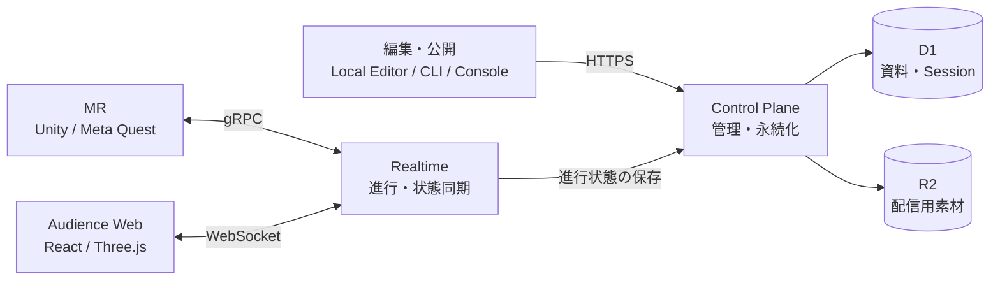
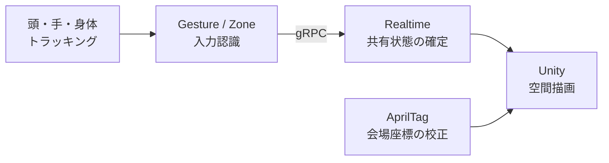
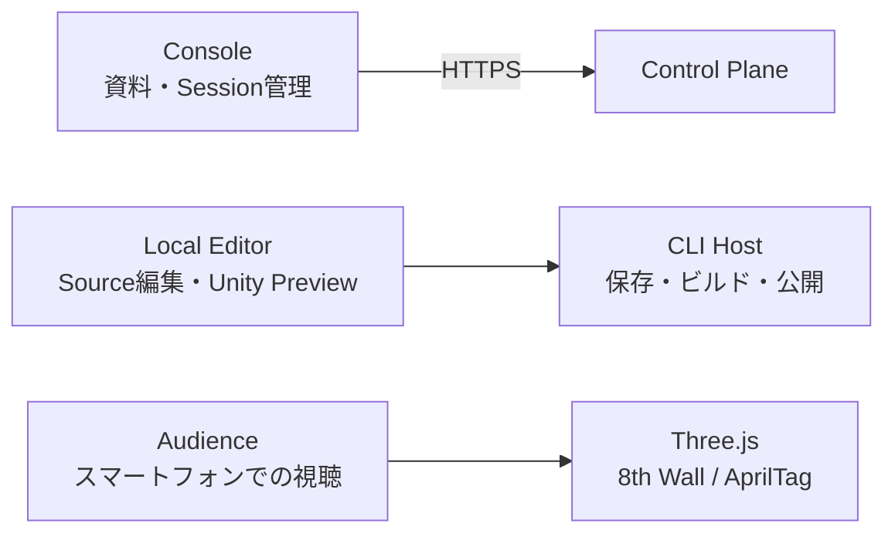
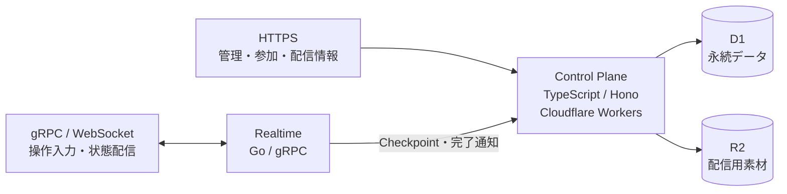
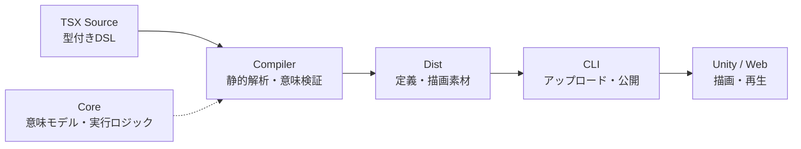

Unframe

  <h1>Unframe</h1>
  
身体を使う MRプレゼンテーション

---
class: final-deck final-install
---

デモの事前準備

<h1>Meta Questへのインストール</h1>

  

    
    
Meta Quest用 · インストール

  

  

    <ol class="final-install-steps">
      <li>01
スマートフォンで QRコードを読み取る
</li>
      <li>02
開いたページで認証する
</li>
      <li>03
認証後、Meta Questを起動する
</li>
    </ol>
  

---
layout: none
class: final-prelude
---

  
Meta Quest

  
  
インストール用

  

<GradientWave id="final-chapter-01" class="chapter-wave" />

01

  
SECTION 01

  <h1>自己紹介</h1>

  

---
layout: none
class: final-prelude
---

  
Meta Quest

  
  
インストール用

  

<GradientWave id="profile-wave-sato" class="profile-wave" />

01 — 自己紹介

  

    
    
柿氷

    

      
<SocialIcon platform="x" />@kakakisann

      
<SocialIcon platform="github" />@kakgr

    

  

  

    <h1>佐藤 和貴</h1>
    <dl class="profile-details">
      
<dt>今回の担当</dt><dd>MR部分</dd>

      
<dt>技術スタック</dt><dd>Vulkan / Metal ・ HLSL / GLSL ・ C# / C++</dd>

      
<dt>趣味</dt><dd>ゲーム ・ TRPG ・ 写真</dd>

      
<dt>関心分野</dt><dd>グラフィックス・シェーダー</dd>

    </dl>
  

  

<!-- Source: /home/t4ko/Project/github.com/unframe-dev/unframe/assets/boost.pdf p.6 -->

---
layout: none
class: final-prelude
---

  
Meta Quest

  
  
インストール用

  

<GradientWave id="profile-wave-gondai" class="profile-wave" flip />

01 — 自己紹介

  

    
    
T4ko0522

    

      
<SocialIcon platform="x" />@T4ko0522

      
<SocialIcon platform="github" />@T4ko0522

      
https://t4ko.pet

    

  

  

    <h1>権代 颯士</h1>
    <dl class="profile-details">
      
<dt>今回の担当</dt><dd>Web / Infra / Backend</dd>

      
<dt>好きな技術</dt><dd>Nix / TypeScript | Hono / Cloudflare</dd>

      
<dt>趣味</dt><dd>モータースポーツ観戦（F1, SF） / VRC / FPSゲーム</dd>

      
<dt>関心分野</dt><dd>Nix, Architecture, Linux</dd>

    </dl>
  

  

---
layout: none
class: final-prelude
---

  
Meta Quest

  
  
インストール用

  

<GradientWave id="final-chapter-02" class="chapter-wave" />

02

  
SECTION 02

  <h1>Unframeの概要</h1>

  

---
layout: none
class: final-prelude
---

  
Meta Quest

  
  
インストール用

  

<GradientWave id="final-overview" class="final-wave" />

02 — Unframeの概要

<h1>身体を使う MRプレゼンテーション</h1>

  <section><h2>身体に連動した操作</h2>
移動・ジェスチャーによる 進行の制御
</section>
  <section><h2>空間的な表現</h2>
従来通りのモニターの平面に限定せず、 文字・画像・3Dモデルを空間的に配置
</section>

  

---
layout: none
class: final-prelude
---

  
Meta Quest

  
  
インストール用

  

02 — Unframeの概要

<h1>MR空間の共有</h1>

  
<h2>プレゼンテイター</h2>
MRヘッドセットで操作・表示

  
同じ MR空間

  
<h2>オーディエンス</h2>
MRヘッドセットや スマートフォンで視聴

「スライド」というまとまりのない構成<small>空間内のコンテンツと演出を、連続した進行として定義</small>

  

---
layout: none
class: final-prelude
---

  
Meta Quest

  
  
インストール用

  

<GradientWave id="final-chapter-03" class="chapter-wave" />

03

  
SECTION 03

  <h1>目標</h1>

  

---
layout: none
class: final-prelude
---

  
Meta Quest

  
  
インストール用

  

<GradientWave id="final-goal-current" class="final-wave" />
<h1>Unframeの目標</h1>

「MRならではの表現」と 「人が使いたいと思える理由」を両立する 手法の探求・提案

  

---
layout: none
class: final-prelude
---

  
Meta Quest

  
  
インストール用

  

<GradientWave id="final-goal-origin" class="final-wave" />
<h1>当初の目標と課題</h1>

  <section><h2>当初の目標</h2>
一つのプレゼンテーションアプリとしての完成
</section>
  <section><h2>開発を通じて明らかになった課題</h2>
従来の手法で完結する場面の多さ MRの特長を活かす表現設計の難しさ ユーザーがプレゼンを作りやすい体験の提供
</section>

  

---
layout: none
class: final-prelude
---

  
Meta Quest

  
  
インストール用

  

<GradientWave id="final-goal-shift" class="final-wave" />
<h1>方針転換</h1>

アプリとしての完成から 「MRでプレゼンテーションを行う意味」 そのものの探求へ

  

---
layout: none
class: final-prelude
---

  
Meta Quest

  
  
インストール用

  

<GradientWave id="final-chapter-04" class="chapter-wave" flip />

04

  
SECTION 04

  <h1>デモプレゼン</h1>

  

---
class: final-deck final-demo-start
---

04 — デモプレゼン

  

    
    
WebXR · デモ視聴

  

  

    <h1>デモプレゼンテーション</h1>
    
スマートフォンでQRコードを読み取り、 視聴ページに接続

  

---
class: final-deck final-tech
---

<h1>05 技術構成 全体図</h1>

  
<strong>HTTPS</strong> 認証・参加・配信情報の取得

  
<strong>gRPC / WebSocket</strong> 操作入力と共有状態の同期

  
<strong>R2</strong> 端末への素材配信

<!--
根拠: app/server/control-plane/src、app/server/realtime/ARCHITECTURE.md、app/web各package.json、app/unity/README.md。
QuestおよびAudienceはControl Planeから参加・配信情報を取得し、素材をHTTPSで取得。図では認証と素材取得の接続線を省略。
-->

---
class: final-deck final-tech
---

<h1>技術構成 MR</h1>

  
<strong>Meta Quest / Unity 6 / C#</strong> OpenXR・Meta XR SDK

  
<strong>入力と描画の分離</strong> 端末で認識し、サーバーで進行を確定

<!--
根拠: app/unity/Packages/manifest.json、app/unity/README.md、app/unity/Assets/Scripts/PresentationRuntime/Quest/PresenterRecognition.cs。
AprilTag検出には任意導入のOpenCV for Unityを使用。共有状態からPNG・テキスト・GLB・動画を描画。Quest実機での総合動作・性能の検証は継続中。
-->

---
class: final-deck final-tech final-tech-web
---

<h1>技術構成 Web</h1>

  
<strong>React 19</strong> 用途別に独立した3つのWebアプリ

  
<strong>Audience</strong> マーカーで空間校正、SLAMで位置を保持

<!--
根拠: app/web/console/package.json、app/web/local-editor/package.json、app/web/audience/package.json、app/web/audience/README.md。
AudienceはWebSocketでRealtimeに接続し、Runtime状態に従ってThree.jsで描画。ConsoleはTanStack Query / Router、AudienceはZustandを使用。
-->

---
class: final-deck final-tech
---

<h1>技術構成 バックエンド</h1>

  
<strong>Control Plane</strong> 認証・権限・資料・Sessionの管理

  
<strong>Realtime</strong> 進行の確定・Snapshot・再接続時の復元

<!--
根拠: app/server/control-plane/package.json、app/server/realtime/go.mod、app/server/realtime/ARCHITECTURE.md。
Control PlaneとRealtimeは独立プロセス。高頻度の共有状態処理はRealtime内で完結し、Control Planeへの保存と分離。Fly.io配備・Machine lifecycleは未実装。
-->

---
class: final-deck final-tech
---

<h1>技術構成 フレームワーク</h1>

  
<strong>Unframe独自の記述・コンパイル基盤</strong> 空間配置・入力条件・演出をTSXで定義

  
<strong>実行環境との分離</strong> 共通の成果物を各クライアントで利用

<!--
根拠: packages/unframe-core/ARCHITECTURE.md、packages/unframe-compiler/ARCHITECTURE.md、packages/unframe-compiler/src/index.ts、packages/unframe-cli/package.json、examples/presentation/presentation.unframe.tsx。
CompilerはDefinition / RenderBundle / AssetSet / BuildManifestを生成。Coreは実行環境非依存の型・意味検証・Cue / Timeline純粋実行を提供。TSXは静的にコンパイルし、Reactの画面をQuestでそのまま実行する構成ではない。
-->

---
class: chapter-slide final-section
---

<GradientWave id="final-chapter-06" class="chapter-wave" />

06

  
SECTION 06

  <h1>プレゼンテイターの 視点</h1>

---
class: final-deck final-video
---

<h1>プレゼンテイターの視点</h1>

  <strong>視点動画</strong>16:9

---
class: chapter-slide final-section
---

<GradientWave id="final-chapter-07" class="chapter-wave" flip />

07

  
SECTION 07

  <h1>振り返り</h1>

---
class: final-deck final-learning
---

07 — 振り返り

<h1>プロダクトとマネジメントの学び</h1>

  <section><h2>プロダクト</h2>
利用者と利用場面の明確化 体験全体の設計
</section>
  <section><h2>マネジメント</h2>
優先順位と開発範囲の決定 進行管理と提供方法の設計
</section>

---
class: final-deck final-statement final-user
---

<GradientWave id="final-user-centered" class="final-wave" />

07 — 振り返り

<h1>ユーザー中心設計</h1>

操作負荷の低減と、 発表内容に集中できる体験の設計

---
class: chapter-slide final-section
---

<GradientWave id="final-chapter-08" class="chapter-wave" />

08

  
SECTION 08

  <h1>今後の展望</h1>

---
class: final-deck final-statement final-future
---

<GradientWave id="final-future" class="final-wave" flip />

08 — 今後の展望

<h1>空間編集エディターの設計</h1>

空間編集の操作性と学習負荷の改善 未踏などの支援プログラムへの挑戦と継続開発

---
class: final-deck final-closing
---

<GradientWave id="final-thanks" class="final-wave" />

Unframe

<h1>ご清聴ありがとうございました</h1>
